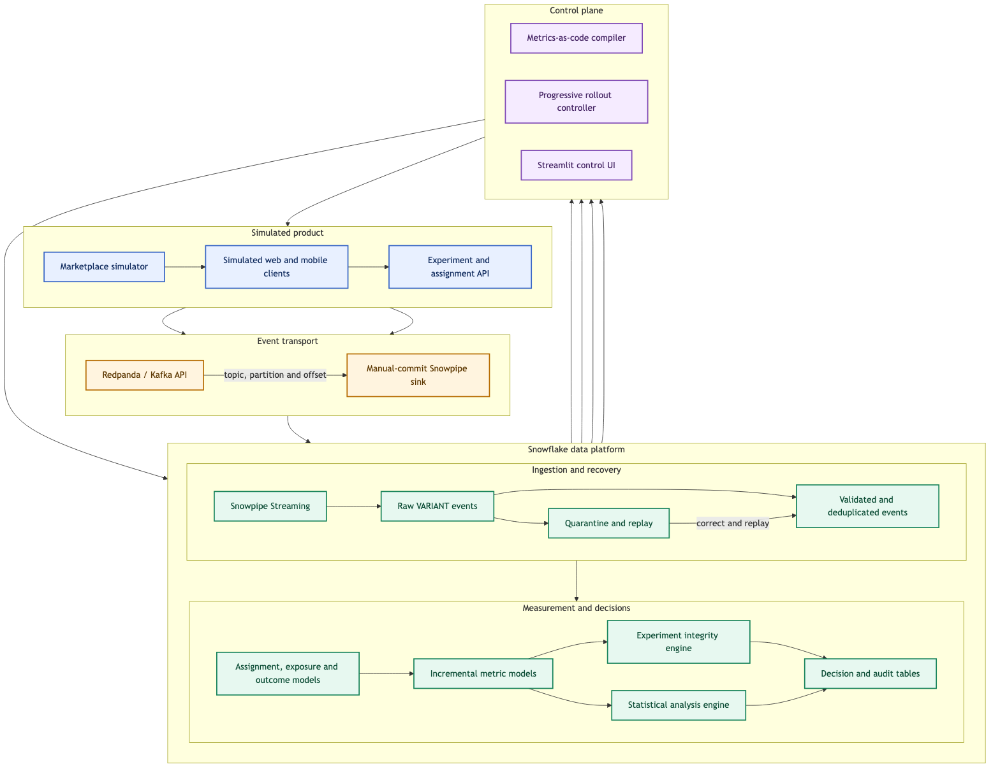
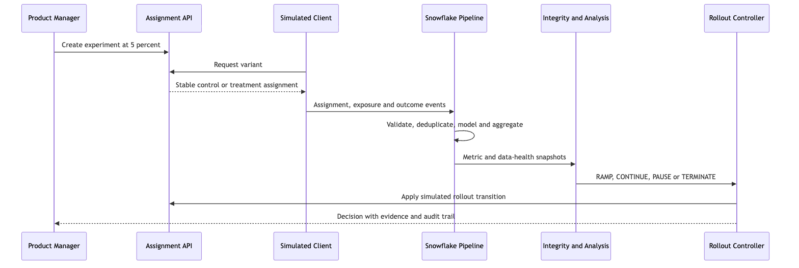
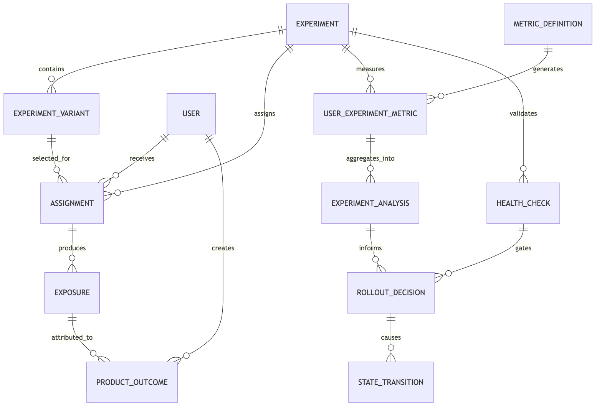
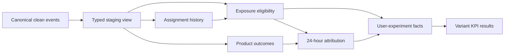
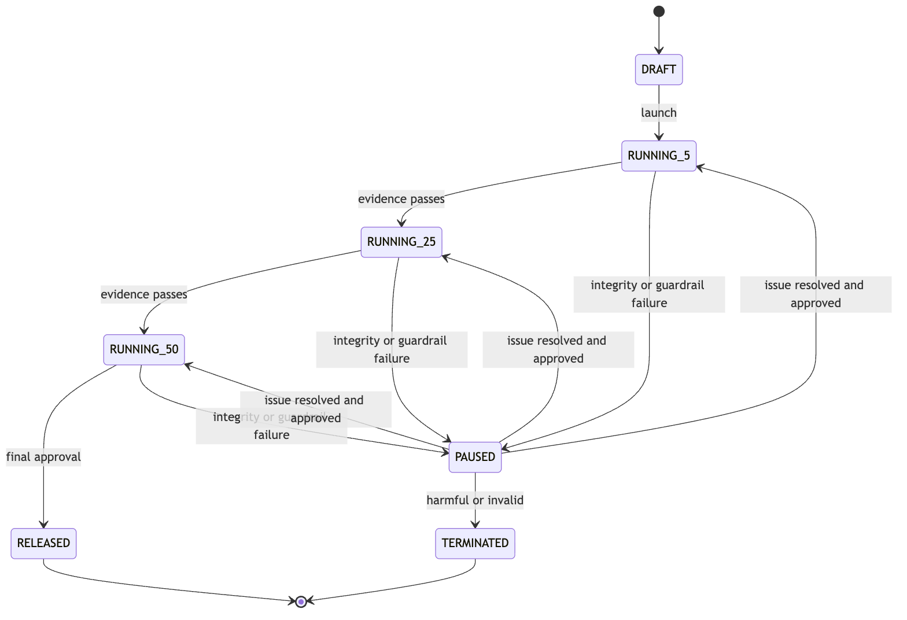

# Guardrail

> A Snowflake-powered experimentation and progressive-delivery platform for making safer product-launch decisions.

**Project status:** Phases 0–3 complete; Phase 4 integrity and statistics is underway
**Primary focus:** Data engineering, product infrastructure, experimentation, and reliable event processing
**Reference domain:** A simulated food-delivery marketplace

**Progress:** 35 of 50 delivery items complete (70%) — see the
[project progress tracker](docs/PROJECT_PROGRESS.md) for shipped evidence, active
work, risks, and the next milestone.

Guardrail is a portfolio project that models the kind of internal data product used by product-led companies to test and release customer-facing features. Rather than stopping at ingestion and dashboards, Guardrail connects the complete decision loop:

1. Assign users consistently to an experiment variant.
2. Capture assignment, exposure, and product-outcome events.
3. Process those events incrementally in Snowflake.
4. Detect experiment and data-integrity problems.
5. Calculate trustworthy product metrics and statistical results.
6. Recommend whether to ramp, continue, pause, or terminate a rollout.
7. Preserve an auditable explanation for every decision.

The first use case tests a new restaurant-ranking algorithm. The treatment should improve completed orders without causing unacceptable increases in cancellations, payment failures, or delivery time.

---

## Current implementation

The first vertical slice is runnable locally and includes:

- FastAPI experiment creation, lookup, and launch endpoints
- Deterministic SHA-256 bucket assignment with stable allocation versions
- A thread-safe in-memory development store
- Versioned Pydantic experiment and product-event contracts
- Synthetic customer journeys for a food-delivery marketplace
- Configurable duplicate, late-event, exposure-loss, and variant-flicker faults
- Simulation summaries with control/treatment counts and fault evidence
- Unit and API tests for allocation stability, distribution, lifecycle, and faults
- Docker and native `uv` development paths
- A reusable Snowflake PAT connection adapter and safe identity-check command
- Repeatable Snowflake role and platform bootstrap SQL
- High-performance Snowpipe Streaming ingestion with resumable channel offsets
- Append-only raw event storage with canonical payload hashes
- Contract/version validation and structured invalid-event quarantine
- Idempotent clean-layer deduplication by stable `event_id`
- Per-batch ingestion audit and producer-to-clean reconciliation evidence
- A `/events` API and optional simulation persistence through a selectable transport
- Corrected-event replay with deterministic request identity, rejection lineage,
  state transitions, failure evidence, and idempotent completed retries
- A three-partition Redpanda topic and Redpanda Console in Docker Compose
- Broker-acknowledged, idempotent event publishing with exact partition/offset receipts
- A manual-commit Redpanda-to-Snowpipe worker that retains source lineage and advances
  consumer offsets only after balanced Snowflake reconciliation
- A strict Draft 2020-12 event envelope, nine version-1 schemas, and nine valid examples
- Contract compatibility tests spanning JSON Schema, Pydantic, simulator output, and
  the Snowflake event registry
- Four accepted ADRs covering identity, delivery semantics, raw retention, and the
  source-offset commit boundary
- GitHub Actions quality and production-container build jobs with pinned actions
- A dbt 1.12 analytics DAG with typed staging and explicit model grains
- Assignment, exposure, outcome, user-identity, and session facts in Snowflake
- Eligible-exposure filtering and most-recent-touch 24-hour event-time attribution
- User-level experiment facts and control/treatment KPI aggregations
- Eight five-minute Snowflake Dynamic Tables plus source freshness monitoring
- Seventy-four dbt data tests and a repeatable live Phase 3 acceptance command
- A typed integrity engine with sample-ratio mismatch, variant-flicker, and
  assignment/exposure consistency gates
- A version-scoped Snowflake evidence query, executable integrity command, and
  implemented experiment-health API
- Blocking event-loss, late-data, and variant freshness-skew gates plus a non-blocking
  duplicate-delivery operational signal
- Integrity-gated statistical analysis using a pooled two-proportion z-test for
  conversion and Welch's unequal-variance t-test for delivery time
- Treatment-minus-control absolute and relative lift, sparse-data safeguards, a
  Snowflake evidence repository, an executable analysis command, and a results API
- Two-sided 95% confidence intervals plus allocation-aware normal-approximation
  80%-power planning for five-percentage-point conversion and five-minute effects
- Explicit per-variant sample requirements, estimated power, and an `UNDERPOWERED`
  decision gate that preserves descriptive results without permitting a rollout decision

Reproducible analysis snapshots, rollout automation, and the control UI remain planned
in the phases below.

---

## Why this project exists

Typical portfolio projects demonstrate that data can be moved from a source into a warehouse. Guardrail goes further and asks a product-engineering question:

> Can a company safely decide whether to release a feature when its telemetry is duplicated, delayed, incomplete, or statistically misleading?

The project is designed to demonstrate:

- Product-event and experimentation modelling
- Streaming and incremental data processing
- Event-time attribution and late-data handling
- Idempotency, quarantine, reconciliation, and replay
- Metrics-as-code and reusable platform design
- Statistical and practical decision guardrails
- Backend API and state-machine design
- Data quality, observability, security, and cost awareness
- Communication of engineering trade-offs

---

## Product scenario

A product manager wants to test a personalized restaurant-ranking algorithm.

```yaml
experiment: new_ranking_algorithm
hypothesis: Personalized ranking increases completed orders per exposed user.
control: existing_ranking
treatment: personalized_ranking
initial_rollout_percentage: 5
primary_metric: order_conversion_rate
guardrail_metrics:
  cancellation_rate:
    maximum_relative_increase: 0.02
  average_delivery_minutes:
    maximum_absolute_increase: 3
  payment_failure_rate:
    maximum_value: 0.01
```

Guardrail returns one of four decisions:

| Decision | Meaning |
| --- | --- |
| `RAMP` | Integrity checks pass, sufficient evidence exists, and guardrails are healthy. |
| `CONTINUE` | The experiment is healthy but needs more observations or time. |
| `PAUSE` | A data-integrity problem or guardrail regression makes continued exposure unsafe. |
| `TERMINATE` | The experiment is persistently harmful or invalid. |

Guardrail does not directly modify a real production system. For the portfolio implementation, feature assignment and rollout changes are performed against the marketplace simulator.

---

## System architecture



[Editable Mermaid source](docs/architecture/system-architecture.mmd) · [Vector version](docs/architecture/system-architecture.svg)

### Decision loop



[Editable Mermaid source](docs/architecture/decision-loop.mmd) · [Vector version](docs/architecture/decision-loop.svg)

---

## Technology stack

| Layer | Technology | Purpose |
| --- | --- | --- |
| Application language | Python 3.12+ | Simulator, APIs, compiler, analysis, and orchestration |
| API framework | FastAPI + Pydantic | Experiment configuration, assignment, telemetry, and simulation controls |
| Local event platform | Redpanda | Kafka-compatible streaming without a heavy local Kafka setup |
| Event ingestion | Snowpipe Streaming high-performance architecture | Low-latency, offset-aware ingestion into Snowflake through a `PIPE` object |
| Data warehouse | Snowflake | Storage, incremental processing, governance, observability, and analysis |
| Transformation | dbt Core + `dbt-snowflake` | Versioned SQL models, tests, documentation, and lineage |
| Incremental processing | Snowflake Dynamic Tables | Freshness-driven assignment, exposure, outcome, and metric models |
| Workflow automation | Snowflake Tasks and task graphs | Scheduled checks, analysis, replay, and decision workflows |
| Change processing | Snowflake Streams where appropriate | Change capture for procedural or event-triggered workflows |
| Statistics | SciPy / Statsmodels or reviewed SQL implementations | Confidence intervals, proportion tests, Welch's t-test, and power calculations |
| Control UI | Streamlit | Lightweight experiment setup, health, results, and decision-history UI |
| Local environment | Docker Compose | Repeatable API, simulator, Redpanda, and UI development environment |
| Testing | Pytest + dbt tests | Unit, contract, data, integration, and chaos tests |
| CI/CD | GitHub Actions | Linting, tests, dbt validation, and deployment checks |
| Infrastructure | Terraform, introduced after the MVP | Repeatable Snowflake roles, warehouses, schemas, and grants |
| Documentation | Markdown + Mermaid | Architecture, decisions, runbooks, and diagrams |

### Why Snowflake is central

The project intentionally uses Snowflake for more than final reporting:

- Raw semi-structured event storage using `VARIANT`
- Continuous ingestion through Snowpipe Streaming
- Incremental transformations with explicit freshness expectations
- Task graphs for validation, analysis, and replay
- Time Travel for debugging and controlled recovery exercises
- Role-based access, masking, tagging, and resource monitoring
- Query history and warehouse usage for cost and performance analysis

---

## Event model

### Canonical envelope

Every producer event follows a versioned envelope:

```json
{
  "event_id": "018f7c56-4d44-7c62-b2be-3d74d02a9cab",
  "event_name": "order_completed",
  "event_version": 1,
  "user_id": "U123",
  "anonymous_id": "A987",
  "session_id": "S456",
  "experiment_id": "new_ranking_algorithm",
  "variant_id": "treatment",
  "event_timestamp": "2026-08-06T10:00:00Z",
  "sent_timestamp": "2026-08-06T10:00:02Z",
  "received_timestamp": "2026-08-06T10:00:03Z",
  "source": "ios",
  "attributes": {
    "order_id": "O10042",
    "order_amount": 74.5,
    "currency": "AED"
  }
}
```

### Initial event catalog

| Event | Meaning | Important attributes |
| --- | --- | --- |
| `experiment_assigned` | Assignment service selected a variant. | bucket, allocation version, assignment reason |
| `experiment_exposed` | User actually experienced the feature. | feature version, surface |
| `restaurant_viewed` | Restaurant detail was viewed. | restaurant ID, rank, query ID |
| `item_added` | Item was added to a cart. | restaurant ID, item ID, price |
| `checkout_started` | Checkout flow began. | cart ID, order ID, cart value |
| `order_completed` | Payment succeeded and order was created. | order ID, amount, currency |
| `order_cancelled` | Customer, restaurant, or courier cancelled. | order ID, actor, reason |
| `payment_failed` | Payment attempt failed. | order ID, payment provider, error category |
| `delivery_completed` | Order reached the customer. | order ID, delivery duration |

### Versioned contract system

The executable contract catalog lives under
[`contracts/events`](contracts/events/README.md). A reusable envelope constrains
identity, experiment, timestamp, source, and reserved lineage fields. Nine event-level
schemas then lock each `event_name`, version, and attributes object. Matching examples
are validated in CI.

Published contracts are immutable: changing a required field, meaning, or accepted
attribute creates a new `event_version`. The ingestion endpoint intentionally continues
to accept arbitrary JSON objects so invalid producer data can be preserved and
quarantined rather than disappearing at the HTTP boundary.

Compatibility tests ensure these sets remain identical:

- JSON Schema event names and versions
- Example files
- The Python `EventName` enum and `ProductEvent` model
- The Snowflake `CONFIG.EVENT_CONTRACTS` seed
- Events emitted by the marketplace simulator

### Event-processing guarantees

Guardrail targets **effectively-once analytical processing**, not an unrealistic end-to-end exactly-once claim. It combines:

- Stable `event_id` generation
- Ordered producer channels where available
- Ingestion-offset tracking
- Idempotent merges and deduplication
- Append-only raw retention
- Source-to-target reconciliation
- Quarantine and controlled replay

Both `event_timestamp` and `received_timestamp` are retained so that event-time metrics and ingestion-latency SLAs can be evaluated separately.

The rationale and rejected alternatives are recorded in the
[architecture decision index](docs/decisions/README.md).

---

## Snowflake organisation

```text
GUARDRAIL
├── CONFIG
│   ├── EXPERIMENTS
│   ├── EXPERIMENT_VARIANTS
│   ├── EVENT_CONTRACTS
│   ├── METRIC_DEFINITIONS
│   └── ROLLOUT_POLICIES
├── RAW
│   ├── PRODUCT_EVENTS
│   ├── INGESTION_AUDIT
│   ├── REJECTED_EVENTS
│   └── REPLAY_QUEUE
├── CLEAN
│   ├── PRODUCT_EVENTS_VALIDATED
│   ├── PRODUCT_EVENTS_DEDUPLICATED
│   └── STG_PRODUCT_EVENTS
├── CORE
│   ├── FCT_EXPERIMENT_ASSIGNMENTS
│   ├── FCT_EXPERIMENT_EXPOSURES
│   ├── FCT_PRODUCT_OUTCOMES
│   ├── FCT_ATTRIBUTED_OUTCOMES
│   ├── FCT_USER_SESSIONS
│   └── DIM_USERS
├── METRICS
│   ├── FCT_USER_EXPERIMENT_METRICS
│   └── AGG_EXPERIMENT_RESULTS
├── CONTROL
│   ├── EXPERIMENT_HEALTH_CHECKS
│   ├── EXPERIMENT_ANALYSES
│   ├── ROLLOUT_DECISIONS
│   └── STATE_TRANSITIONS
└── OBSERVABILITY
    ├── PIPELINE_RUNS
    ├── DATA_FRESHNESS
    ├── RECONCILIATION_RESULTS
    └── COST_ATTRIBUTION
```

### Data flow by layer

| Layer | Responsibility |
| --- | --- |
| `RAW` | Preserve immutable producer payloads and ingestion metadata. |
| `CLEAN` | Validate contracts, normalize types, quarantine failures, and deduplicate. |
| `CORE` | Model assignments, true exposures, user identity, and attributed outcomes. |
| `METRICS` | Calculate reusable user-level and experiment-level metrics. |
| `CONTROL` | Store integrity checks, statistical results, rollout decisions, and state changes. |
| `OBSERVABILITY` | Track freshness, reconciliation, execution, performance, and cost. |

### Logical data model



[Editable Mermaid source](docs/architecture/logical-data-model.mmd) · [Vector version](docs/architecture/logical-data-model.svg)

### Streaming transport and Phase 2 ingestion flow

The runnable ingestion slice deliberately preserves the raw record before applying
analytical correctness rules:

1. `POST /events` accepts 1–1,000 JSON event objects, including malformed records
   that need to be quarantined rather than rejected at the HTTP boundary.
2. In `redpanda` mode, the producer wraps each event in a versioned transport
   envelope, waits for broker acknowledgements, and returns the exact topic,
   partition, and offset receipt. Events for the same experiment subject share a key.
3. The sink worker consumes with automatic commits disabled, adds Redpanda source
   lineage to the payload, and forwards the batch to Snowpipe Streaming.
4. Snowpipe Streaming adds its batch ID, deterministic channel offset, source
   metadata, and SHA-256 hash, then writes through
   `RAW.PRODUCT_EVENTS_STREAMING` into the
   append-only `RAW.PRODUCT_EVENTS` table.
5. `CONTROL.PROCESS_INGESTION_BATCH` validates the registered event name/version and
   required analytical fields.
6. Valid records enter `CLEAN.PRODUCT_EVENTS_VALIDATED`; invalid records enter
   `RAW.REJECTED_EVENTS` with a structured reason.
7. A `MERGE` maintains one canonical row per `event_id` in
   `CLEAN.PRODUCT_EVENTS_DEDUPLICATED`.
8. The batch finishes only after `RAW.INGESTION_AUDIT` and
   `OBSERVABILITY.RECONCILIATION_RESULTS` prove the counts balance.
9. Only then does the worker synchronously commit the next offset for every consumed
   partition. Failure or unbalanced reconciliation leaves those offsets uncommitted.

Snowpipe channel offsets protect transport progress, while `event_id` protects
analytical identity. These are separate guarantees: retrying a payload can create an
auditable raw duplicate without duplicating the clean analytical event.

For focused native development and replay, `snowpipe` mode remains available as a
direct dispatcher. Docker Compose uses the buffered `redpanda` path by default.

### Phase 3 analytics flow

The delivered dbt DAG separates record eligibility from record retention. Every
exposure stays queryable, but only a record with a preceding, variant-consistent
assignment can contribute to a metric. Outcomes use the most recent eligible
exposure inside a 24-hour event-time window.



Snowflake maintains the six `CORE` and two `METRICS` models as Dynamic Tables with
a five-minute target lag. dbt adds lineage, documentation, source freshness, and 74
quality checks. See the [analytics DAG guide](dbt_guardrail/README.md) for model
grains and detailed rules.

---

## Assignment and exposure semantics

Assignment and exposure are deliberately separate:

- **Assignment:** the service selected a variant for a user.
- **Exposure:** the user actually saw or used the treatment.
- **Outcome:** the user performed an action eligible for attribution.

A deterministic assignment bucket is implemented as:

```text
bucket = SHA256(experiment_id + ":" + subject_id) mod 10000
```

The allocation configuration maps bucket ranges to variants. Allocation changes are versioned, and the original assignment version is preserved.

This design supports checks for:

- Users switching between variants
- Assigned users who were never exposed
- Exposure without a recorded assignment
- Outcomes that occurred before exposure
- Cross-device identity inconsistencies
- Changes in allocation during a running experiment

---

## Metrics as code

Metrics are versioned product definitions rather than dashboard-specific SQL.

```yaml
name: order_conversion_rate
version: 1
description: Share of exposed users who complete an order within 24 hours.
owner: marketplace-growth
entity: user_id
type: proportion
numerator:
  event: order_completed
denominator:
  event: experiment_exposed
attribution_window: 24_hours
direction: increase
minimum_detectable_effect: 0.02
```

The planned compiler will:

1. Validate the YAML definition against a schema.
2. Resolve event and entity references against registered contracts.
3. Generate parameterized, reviewable Snowflake SQL.
4. Create or update the corresponding dbt or Dynamic Table model.
5. Attach standard uniqueness, null, freshness, and reconciliation tests.
6. Record the compiled SQL hash and metric version.
7. Require validation before the metric can be activated.

Changing a metric creates a new version so previous experiment results remain reproducible.

---

## Experiment integrity engine

Statistical results are produced only after required integrity checks pass.

| Check | Question answered | Example response |
| --- | --- | --- |
| Sample ratio mismatch | Does observed allocation match configured allocation? | Block analysis and pause ramping. |
| Variant flicker | Did a subject appear in multiple variants? | Exclude or invalidate according to policy. |
| Assignment/exposure gap | Are assignments producing expected exposures? | Flag client or telemetry problems. |
| Exposure without assignment | Can exposure be tied to an assignment record? | Quarantine from analysis. |
| Duplicate exposure | Is client retry behaviour inflating counts? | Deduplicate using the declared grain. |
| Event-order violation | Did outcomes appear before exposure? | Reject attribution or wait for late data. |
| Freshness skew | Is one variant receiving data later than another? | Delay the decision. |
| Event-loss anomaly | Did expected event volume change unexpectedly? | Pause and investigate ingestion. |
| Late-data rate | Is the attribution window sufficiently complete? | Continue collecting data. |
| Minimum sample size | Is there enough information to make a decision? | Continue the experiment. |

Each check emits a structured result with severity, observed value, expected range, evidence query, and recommended action.

---

## Statistical analysis

The initial analysis engine intentionally stays focused. The first five capabilities
are implemented; the remaining guardrails are Phase 5 work:

- Difference in proportions for conversion-style metrics — **implemented**
- Welch's t-test for continuous metrics — **implemented**
- Absolute and relative lift — **implemented**
- Confidence intervals — **implemented**
- Minimum sample size and power calculation — **implemented**
- Practical-significance thresholds
- Multiple-metric guardrail evaluation

An experiment cannot be declared successful solely because `p < 0.05`. A rollout decision requires:

1. Required integrity checks to pass.
2. Minimum sample size and runtime to be satisfied.
3. Primary metric evidence to meet configured rules.
4. Practical impact to exceed its threshold.
5. Every blocking guardrail to remain within tolerance.
6. Results to be stable for the configured decision window.

Advanced Bayesian methods, sequential testing, CUPED, and multi-armed bandits are explicitly deferred until the core platform is correct and reproducible.

---

## Progressive rollout state machine



[Editable Mermaid source](docs/architecture/rollout-state-machine.mmd) · [Vector version](docs/architecture/rollout-state-machine.svg)

Every transition records:

```text
experiment_id
previous_state
new_state
decision
decision_reason
metric_snapshot_id
health_snapshot_id
policy_version
requested_by
approved_by
created_at
```

Automated recommendations remain explainable. Human approval can be required for any ramp or final release.

---

## API surface

| Method | Endpoint | Purpose |
| --- | --- | --- |
| `GET` | `/health` | Check that the API is ready. **Implemented.** |
| `POST` | `/experiments` | Create a draft experiment. **Implemented.** |
| `GET` | `/experiments/{experiment_id}` | Read configuration and current state. **Implemented.** |
| `POST` | `/experiments/{experiment_id}/launch` | Begin the initial rollout. **Implemented.** |
| `GET` | `/assignments/{experiment_id}/{subject_id}` | Return a deterministic variant assignment. **Implemented.** |
| `POST` | `/simulations` | Run a synchronous marketplace simulation. **Implemented.** |
| `POST` | `/events` | Publish telemetry to the configured acknowledged transport. **Implemented.** |
| `GET` | `/rejections/{rejection_id}` | Inspect a quarantined event and its replay status. **Implemented.** |
| `POST` | `/rejections/{rejection_id}/replay` | Validate and replay a corrected event with lineage. **Implemented.** |
| `POST` | `/simulations/{simulation_id}/failures` | Inject a selected data failure. |
| `GET` | `/experiments/{experiment_id}/health` | Return allocation, consistency, and telemetry-health results. **Implemented.** |
| `GET` | `/experiments/{experiment_id}/results` | Return integrity-gated metric and statistical results. **Implemented.** |
| `GET` | `/experiments/{experiment_id}/decisions` | Return rollout decision history. |
| `POST` | `/experiments/{experiment_id}/transitions` | Approve or apply an allowed transition. |

---

## Repository structure

The implementation will grow into the following structure:

```text
guardrail-experimentation-platform/
├── README.md
├── docs/
│   ├── architecture/
│   ├── decisions/
│   ├── runbooks/
│   └── demo/
├── contracts/
│   ├── events/
│   ├── metrics/
│   └── experiments/
├── services/
│   ├── assignment_api/
│   ├── event_producer/
│   ├── marketplace_simulator/
│   ├── metric_compiler/
│   ├── analysis_engine/
│   └── rollout_controller/
├── snowflake/
│   ├── ddl/
│   ├── pipes/
│   ├── dynamic_tables/
│   ├── streams/
│   ├── tasks/
│   ├── procedures/
│   ├── security/
│   └── observability/
├── dbt_guardrail/
│   ├── models/
│   │   ├── staging/
│   │   ├── core/
│   │   ├── metrics/
│   │   └── control/
│   ├── macros/
│   ├── seeds/
│   └── tests/
├── ui/
├── tests/
│   ├── unit/
│   ├── integration/
│   ├── contracts/
│   ├── data/
│   └── chaos/
├── infrastructure/
│   ├── docker/
│   └── terraform/
├── scripts/
├── .github/workflows/
├── docker-compose.yml
├── pyproject.toml
└── .env.example
```

---

## Delivery plan

The estimated timeline is **6–8 weeks part-time**. Each phase ends with a demonstrable outcome.

### Phase 0 — Product and system design

**Duration:** 2–3 days

- [x] Define the restaurant-ranking experiment scenario.
- [x] Define the target system architecture.
- [x] Define the initial event catalog and canonical envelope.
- [x] Define the Snowflake layers and logical model.
- [x] Define the delivery phases and scope boundaries.
- [x] Create detailed architecture-decision records.
- [x] Define JSON schemas for every event version.

**Exit criterion:** The system, contracts, experiment rules, and MVP boundary are documented before implementation.

### Phase 1 — Marketplace simulator and assignment service

**Duration:** 1 week

- [x] Create the FastAPI service.
- [x] Implement experiment configuration and validation.
- [x] Implement deterministic assignment and allocation versioning.
- [x] Generate customers, restaurants, sessions, carts, orders, and deliveries.
- [x] Run Redpanda locally with Docker Compose.
- [x] Generate healthy and deliberately faulty telemetry.
- [x] Add unit and API contract tests.

**Exit criterion:** The same user always receives the expected variant, at least 10,000 journeys can be generated, and failures can be injected by configuration.

### Phase 2 — Snowflake ingestion and raw layer

**Duration:** 1 week

- [x] Create databases, schemas, roles, warehouses, and grants.
- [x] Configure high-performance Snowpipe Streaming with PAT authentication.
- [x] Preserve raw payloads in an append-only table.
- [x] Validate event contracts and versions.
- [x] Deduplicate by stable event identity.
- [x] Quarantine invalid records with structured reasons.
- [x] Implement replay status and recovery workflow.
- [x] Reconcile producer, raw, validated, rejected, and duplicate counts.

**Exit criterion:** Valid and invalid records are separated, re-ingestion is idempotent, counts reconcile, and a corrected record can be replayed.

### Phase 3 — Experiment models and product metrics

**Duration:** 1 week

- [x] Build assignment, exposure, and outcome models.
- [x] Implement identity and session handling.
- [x] Attribute outcomes using event time and a 24-hour window.
- [x] Build user-level experiment metric facts.
- [x] Build control and treatment aggregations.
- [x] Configure incremental Dynamic Tables.
- [x] Add dbt quality and freshness tests.

**Exit criterion:** Snowflake can answer exposure, conversion, lift, guardrail, and freshness questions for each variant.

> **MVP checkpoint:** At the end of Phase 3, Guardrail is an end-to-end product telemetry and experimentation data pipeline.

### Phase 4 — Integrity and statistical analysis

**Duration:** 1 week

- [x] Implement sample ratio mismatch detection.
- [x] Detect variant flicker and assignment/exposure inconsistencies.
- [x] Detect freshness skew, event loss, duplicates, and late data.
- [x] Implement proportion and continuous metric analysis.
- [x] Calculate confidence intervals and required sample size.
- [x] Block statistical decisions when required checks fail.
- [ ] Persist reproducible analysis snapshots.

**Exit criterion:** A healthy experiment produces a result, while deliberately corrupted experiments are correctly blocked.

### Phase 5 — Metrics-as-code and rollout automation

**Duration:** 1–1.5 weeks

- [ ] Define the metric YAML schema.
- [ ] Validate event, entity, and attribution references.
- [ ] Compile definitions into reviewable Snowflake SQL.
- [ ] Version metric definitions and compiled artefacts.
- [ ] Implement the rollout state machine.
- [ ] Evaluate rollout and guardrail policies.
- [ ] Persist explainable decision and transition records.

**Exit criterion:** A new metric can be added without handwritten model SQL, healthy experiments can ramp, and harmful experiments pause automatically.

### Phase 6 — UI, chaos demo, and portfolio packaging

**Duration:** 1 week

- [ ] Build Streamlit experiment configuration and result pages.
- [ ] Visualize integrity, freshness, metrics, and decisions.
- [ ] Script three reproducible demo scenarios.
- [ ] Add CI checks and end-to-end tests.
- [ ] Add Snowflake cost and query-performance analysis.
- [ ] Complete setup guides and operational runbooks.
- [ ] Record a five-minute demo video.

**Exit criterion:** Another developer can clone the repository, deploy the required components, reproduce each scenario, and understand every rollout decision.

---

## Demo scenarios

### 1. Healthy rollout

The personalized ranking increases conversion, all integrity checks pass, guardrails remain healthy, and the controller recommends moving from 5% to 25%.

### 2. False winner caused by telemetry corruption

Some mobile users switch variants after an identity change. The treatment appears to win, but Guardrail detects flicker, blocks the statistical conclusion, and pauses rollout until identity resolution and replay are complete.

### 3. Locally successful but globally harmful feature

Treatment improves checkout conversion but raises cancellations and delivery time. Guardrail rejects the rollout because product success is evaluated against the complete customer experience.

The second scenario is the primary interview demonstration because it shows why data engineering correctness directly affects product decisions.

---

## Testing strategy

| Test type | Coverage |
| --- | --- |
| Unit | Hash assignment, schemas, compiler rules, state transitions, and statistical functions |
| Contract | Event-envelope and version compatibility |
| dbt data | Uniqueness, non-null keys, relationships, accepted values, and business invariants |
| Integration | API to Redpanda, ingestion to Snowflake, and analysis to decision records |
| Reconciliation | Producer counts, raw ingestion counts, clean counts, and quarantine counts |
| Property-based | Assignment stability and allocation distribution |
| Chaos | Duplicates, lateness, missing fields, out-of-order events, event loss, and variant flicker |
| Regression | Fixed experiment fixtures with expected metrics and decisions |

Critical invariants include:

```text
one active assignment per experiment subject and allocation version
exposure_timestamp >= assignment_timestamp
attributed_outcome_timestamp >= exposure_timestamp
valid_events + rejected_events = received_events
released experiments have no blocking integrity or guardrail failure
```

---

## Observability and cost controls

Guardrail will monitor both data health and platform operation:

- Producer-to-ingestion latency
- Event-time lateness distribution
- Snowpipe ingestion errors
- Quarantine and replay volume
- Dynamic Table refresh duration and actual lag
- Task failures and retries
- Reconciliation differences
- Experiment-result computation duration
- Credits by warehouse, pipeline stage, and experiment
- Query scan volume and spill behaviour

Planned cost controls:

- Separate ingest, transform, and analysis warehouses
- Aggressive auto-suspend for development warehouses
- Explicit resource monitors
- Incremental refresh where supported and justified
- A relaxed development freshness target
- Synthetic-data volume profiles instead of uncontrolled generation
- A documented comparison of latency versus credit consumption

---

## Security and governance

The initial design includes:

- Separate service, engineer, analyst, and UI roles
- Least-privilege schema and warehouse grants
- A role-restricted Snowflake PAT for local development, stored in an ignored file
- OAuth client credentials or workload identity as the deployment upgrade path
- No credentials committed to the repository
- `.env.example` containing names only, never secrets
- Masking policies for simulated email, phone, and payment identifiers
- Row-access policies if multi-team experiment ownership is introduced
- Query tags for pipeline, experiment, and cost attribution
- Immutable decision and transition history
- Metric, event-contract, and rollout-policy ownership metadata

All data is synthetic. This repository should not require or contain real customer information.

---

## Local development

### Prerequisites

- Git
- [`uv`](https://docs.astral.sh/uv/) for the recommended native workflow
- Docker Desktop only if using the container workflow

`uv` automatically installs the required Python 3.12 runtime, so a separate Python installation is not required.

### Run natively

```bash
uv sync
uv run pytest tests/test_event_contracts.py
uv run ruff check .
uv run pytest
uv run uvicorn guardrail.main:app --reload
```

Open the interactive API documentation at <http://localhost:8000/docs>.

Verify the Snowflake identity without printing credentials:

```bash
uv run guardrail-snowflake-check
```

Apply the idempotent Phase 2 ingestion objects and run the live acceptance test:

```bash
uv run guardrail-snowflake-setup-ingestion
uv run guardrail-phase2-smoke
uv run guardrail-phase2-replay-smoke
```

The smoke command deliberately streams three records: one valid event, the same
event again, and one malformed event. A successful result reports `raw_count: 3`,
`validated_count: 2`, `rejected_count: 1`, `duplicate_count: 1`, and
`is_balanced: true`.

The replay smoke command corrects one quarantined record and submits the identical
request twice. A successful result reports `COMPLETED`, `attempt_count: 1`, one raw
replay row, matching rejection lineage, and `idempotent: true`.

Start the local broker and Console, then verify the complete
Redpanda-to-Snowflake route:

```bash
docker compose up -d redpanda redpanda-topic-init redpanda-console
uv run guardrail-redpanda-smoke
```

A successful transport result reports three acknowledged broker offsets, three
preserved source-lineage rows, `raw_count: 3`, `validated_count: 2`,
`rejected_count: 1`, `duplicate_count: 1`, and `is_balanced: true`.

To run the long-lived sink worker natively:

```bash
uv run guardrail-redpanda-worker
```

### Run with Docker

```bash
docker compose up --build
```

This starts the API, Redpanda, the topic initializer, and Redpanda Console. The API
is available at <http://localhost:8000>, its health endpoint is
<http://localhost:8000/health>, and the topic/consumer interface is available at
<http://localhost:8080>.

Include the Snowflake sink worker when you want Docker-generated events to reach the
warehouse:

```bash
docker compose --profile snowflake up --build
```

The worker mounts the ignored `.secrets` directory read-only and obtains non-secret
Snowflake settings from the local `.env` file.

### Continuous integration

The [CI workflow](.github/workflows/ci.yml) runs on pushes, pull requests, and manual
dispatch. Its quality job installs the locked environment, checks contract
compatibility, formatting, lint, the complete test suite, and Docker Compose. A
separate job builds the production container without requiring Snowflake credentials.
Third-party actions are pinned to immutable release commits and the workflow receives
read-only repository permissions.

### Try the first experiment

Create, launch, and simulate an experiment from the Swagger UI, or use:

```bash
curl -X POST http://localhost:8000/experiments \
  -H 'Content-Type: application/json' \
  -d '{
    "experiment_id": "new_ranking_algorithm",
    "name": "Personalized restaurant ranking",
    "hypothesis": "Personalized ranking increases completed orders per exposed user.",
    "primary_metric": "order_conversion_rate"
  }'

curl -X POST http://localhost:8000/experiments/new_ranking_algorithm/launch

curl -X POST http://localhost:8000/simulations \
  -H 'Content-Type: application/json' \
  -d '{
    "experiment_id": "new_ranking_algorithm",
    "subjects": 100,
    "seed": 7,
    "fault_profile": {
      "duplicate_rate": 0.1,
      "late_event_rate": 0.1,
      "flicker_rate": 0.05
    },
    "persist_events": true
  }'
```

Setting `persist_events` to `true` publishes every generated event and returns a
`telemetry_batch_id` plus `telemetry_transport`. In Docker's `redpanda` mode, the
request returns after broker acknowledgement and `ingestion_batch_id` remains null;
the sink worker completes Snowflake ingestion asynchronously. In direct `snowpipe`
mode, the response also returns the committed `ingestion_batch_id`. Leave
`persist_events` false for a local-only run.

### Snowflake and dbt workflow

The dbt wrapper loads non-secret Snowflake settings from `.env`, reads the PAT from
the ignored file, and uses dbt's native programmatic-access-token authentication.
It never requires exporting the token into shell history:

```bash
uv run guardrail-dbt debug
uv run guardrail-dbt build
uv run guardrail-dbt source freshness
uv run guardrail-phase3-smoke
uv run guardrail-phase4-integrity-check ranking_phase3_20260806
uv run guardrail-phase4-analysis ranking_phase3_20260806
```

The build creates one `CLEAN` staging view, six `CORE` Dynamic Tables, and two
`METRICS` Dynamic Tables with a five-minute target lag. The final smoke command
requires at least one persisted experiment journey and verifies non-empty facts,
all eight materializations, and the critical analytical invariants. Detailed model
lineage and grains are documented in the [dbt project guide](dbt_guardrail/README.md).

The Phase 4 command evaluates seven checks: sample-ratio mismatch, variant flicker,
assignment/exposure consistency, event loss, duplicate delivery, late data, and
cross-variant p95 receive-lag skew. It prints structured evidence and exits with status
2 whenever a blocking check fails or lacks enough data. Duplicate delivery is
non-blocking because stable `event_id` deduplication protects analytical facts, while
still surfacing excessive producer or transport retries. Use `--treatment-percentage`
and `--allocation-version` when evaluating another rollout configuration.

The analysis command first runs the same seven integrity checks. If any required check
fails or is inconclusive, it returns `BLOCKED`, omits metric statistics, and exits with
status 2. A healthy experiment continues to a two-sided pooled two-proportion z-test
for conversion and a two-sided Welch test for delivery minutes, returning
treatment-minus-control estimates, lift, 95% confidence intervals, test statistics,
and p-values. Each metric also reports its minimum detectable effect, 80% target power,
estimated power, and allocation-aware control/treatment sample requirement under the
documented normal approximation. A valid but underpowered result remains visible with
status `UNDERPOWERED` and still blocks a statistical decision.

### Setup required from the project owner

Nothing external is required for local simulation or the Redpanda transport. Docker
Desktop is sufficient for the local broker and Console. Persisted Snowflake ingestion
requires:

1. A Snowflake account with available trial credits or a small development budget.
2. One-time access to a role that can create a project role, database, schemas, and warehouses. `ACCOUNTADMIN` can be used for bootstrap only; routine development will use least-privilege Guardrail roles.
3. The Snowflake account identifier, user name, and cloud region. Put non-secret values in a local `.env` copied from `.env.example`.
4. Permission to generate a programmatic access token restricted to `GUARDRAIL_ENGINEER` and configure the network policy required by Snowflake.

The PAT secret belongs in `.secrets/snowflake_pat` with `600` permissions. Only its file path belongs in `.env`. No Snowflake password, PAT, private key, or other secret should be pasted into an issue, README, chat message, or committed file.

After creating the `GUARDRAIL_ENGINEER` role and a role-restricted PAT, run
[`snowflake/bootstrap/01_platform.sql`](snowflake/bootstrap/01_platform.sql)
once in Snowsight as `ACCOUNTADMIN`. Then run
`uv run guardrail-snowflake-setup-ingestion` as `GUARDRAIL_ENGINEER`.
The current development account has completed both steps. Its remaining security
hardening item is replacing the temporary PAT network-policy bypass with a permanent,
restricted network policy.

---

## Non-goals for the initial release

The following are intentionally excluded until the six implementation phases are complete:

- Kubernetes deployment
- Multi-language feature-flag SDKs
- A production-grade React frontend
- Apache Flink or a second streaming engine
- Multi-armed bandits
- Bayesian or sequential experimentation
- Automated causal-inference claims
- AI-generated decisions
- Multiple simulated product domains
- Direct control of a real production feature-flag service

Finishing a focused and reliable system is more valuable than collecting unrelated technologies.

---

## Success criteria

Guardrail is portfolio-ready when it can prove all of the following:

- Stable experiment assignments across retries and service restarts
- End-to-end telemetry ingestion with auditable counts
- Correct handling of duplicates, late events, invalid schemas, and replay
- Separate assignment, exposure, and outcome semantics
- Incremental, tested product metrics in Snowflake
- Detection of sample imbalance and variant flicker
- Reproducible statistical and practical-impact results
- Explainable, policy-driven rollout decisions
- A complete healthy rollout and two failure demonstrations
- Documented performance, freshness, and Snowflake cost trade-offs
- A new developer can reproduce the system from the repository

---

## Interview narrative

The main demonstration tells this story:

> We launched a ranking algorithm to 5% of marketplace users. The treatment appeared to improve conversion by 4.8%, but Guardrail detected that some mobile clients were switching variants after an identity change. The analysis was blocked. After fixing identity resolution and replaying the append-only raw events, the apparent lift disappeared. A later experiment improved conversion without harming cancellation, payment, or delivery guardrails, so the platform recommended a controlled ramp to 25%.

Suggested resume bullet:

> Built a Snowflake-based progressive experimentation platform for simulated marketplace telemetry, combining deterministic assignment, metrics-as-code compilation, incremental result computation, experiment-integrity checks, and auditable rollout guardrails.

---

## Engineering references

- [Snowflake: Snowpipe Streaming key concepts](https://docs.snowflake.com/en/user-guide/snowpipe-streaming/snowpipe-streaming-high-performance-overview)
- [Snowflake: Dynamic Table target lag](https://docs.snowflake.com/en/user-guide/dynamic-tables-target-lag)
- [Snowflake: Introduction to Tasks](https://docs.snowflake.com/en/user-guide/tasks-intro)
- [JSON Schema: Draft 2020-12](https://json-schema.org/draft/2020-12)
- [GitHub Actions: Building and testing Python](https://docs.github.com/en/actions/tutorials/build-and-test-code/python)
- [Airbnb: Experimentation data engineering](https://careers.airbnb.com/positions/7306868)
- [Spotify: Experimentation Platform](https://engineering.atspotify.com/2020/10/spotifys-new-experimentation-platform-part-1)
- [Uber: Experimentation Platform](https://www.uber.com/us/en/blog/xp/)

These references provide architectural inspiration. Guardrail is an independent educational project and is not affiliated with those companies.

---

## License

A license will be selected before the first public release. Apache-2.0 is the current candidate because the project is intended to demonstrate reusable platform components.
