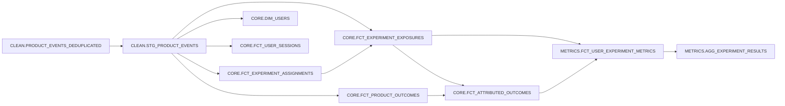

# Guardrail analytics DAG

This dbt project turns contract-valid, identity-deduplicated telemetry into an
experiment-ready measurement layer. Snowflake owns refresh scheduling through a
five-minute target lag; dbt owns SQL, lineage, documentation, and quality gates.



## Model grains and rules

| Model | Grain | Important rule |
| --- | --- | --- |
| `stg_product_events` | canonical `event_id` | Retains the attributes object and exposes typed analytical fields. |
| `fct_experiment_assignments` | assignment event | Preserves allocation version and complete assignment history. |
| `fct_experiment_exposures` | exposure event | Matches the latest preceding assignment and marks orphan or variant-mismatched exposure ineligible. |
| `fct_product_outcomes` | outcome event | Keeps conversion and guardrail events before attribution. |
| `fct_attributed_outcomes` | attributed outcome event | Selects the most recent eligible exposure in the 24-hour event-time window. |
| `dim_users` | user | Tracks identity, session, experiment, and cross-anonymous-ID counts. |
| `fct_user_sessions` | user and session | Summarizes event volume, duration, experiment scope, identities, and lateness. |
| `fct_user_experiment_metrics` | user, experiment, allocation version | Uses the first eligible variant while retaining flicker and mismatch evidence. |
| `agg_experiment_results` | experiment, variant, allocation version | Produces conversion, control-relative lift, cancellation, payment-failure, delivery, and revenue KPIs. |

An exposure contributes to a metric only when a preceding assignment exists and
the exposed variant matches the assigned variant. Invalid exposures remain in the
exposure fact so the integrity layer can measure the problem instead of hiding it.

## Phase 4 integrity consumption

The on-demand integrity engine reads raw delivery identity, canonical event latency,
assignment and exposure facts, and user-experiment metrics. It evaluates sample ratio,
variant flicker, invalid exposures, event loss, duplicate delivery, late data, and
cross-variant p95 receive-lag skew without changing the Phase 3 model grains. Health
results are returned through the CLI and API; persisted health snapshots remain a
later Phase 4 delivery item.

## Run

The repository wrapper reads the ignored PAT file and passes it to dbt's native
`programmatic_access_token` authenticator without placing the token in shell
history:

```bash
uv run guardrail-dbt debug
uv run guardrail-dbt build
uv run guardrail-dbt source freshness
uv run guardrail-phase3-smoke
```

`guardrail-phase3-smoke` expects a persisted simulation so it can prove the facts
and metric tables are non-empty. It also verifies all eight Dynamic Tables and the
attribution, exposure-eligibility, and metric-bound invariants.
